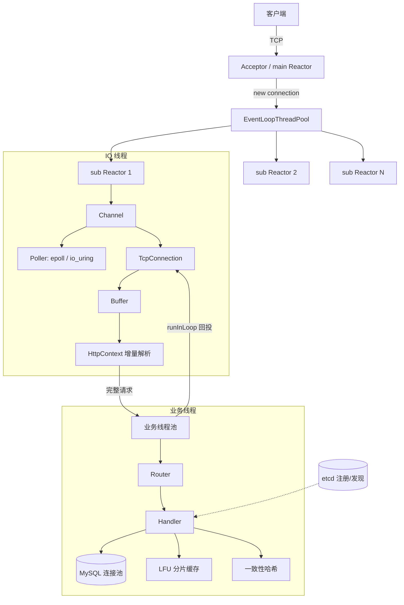

# Helix

**高性能 C++ HTTP 服务器**：epoll / io_uring 双后端 Reactor · 业务线程池异步化 · 分片 LFU 缓存 · etcd 服务发现

Helix 是一个从零实现的 muduo 风格网络服务器，面向高并发请求场景。它在自研 Reactor 网络库之上，接入 HTTP 协议解析、数据库连接池、缓存与服务治理，并通过压测量化每一处优化。

## 特性

- **Multi-Reactor 并发模型**：`one loop per thread`，main Reactor 负责 `accept`，N 个 sub Reactor 负责连接读写；跨线程任务经 `runInLoop/queueInLoop + eventfd` 唤醒投递。
- **I/O 多路复用双后端**：抽象 `Poller` 接口，提供 `EPollPoller` 与 `IoUringPoller`（`IORING_POLL_ADD_MULTI`），通过环境变量 `USE_IOURING` 切换。
- **增量式 HTTP/1.1 解析**：`HttpContext` 状态机（请求行 → 头部 → 请求体），正确处理半包、粘包、`Content-Length` 边界与顺序 keep-alive；路由支持精确与前缀匹配。
- **业务线程池异步化**：所有阻塞业务（数据库、缓存）下沉到有界业务线程池，完成后经 `EventLoop::runInLoop` 回投连接所属 IO 线程发送；队列满时返回 503 背压。
- **连接生命周期管理**：`timerfd + std::set` 实现 O(logN) 定时器；每连接 `runAfter` 空闲定时器 + 活跃刷新，超时统一回收；`Channel` 以 `weak_ptr tie` 绑定连接对象，回调期间提升为 `shared_ptr` 防止 use-after-free。
- **数据库**：MySQL 连接池，RAII 自动归还、事务 `begin/commit/rollback`、`SELECT ... FOR UPDATE` 行锁防超卖、参数转义防 SQL 注入。
- **缓存**：LFU 分片缓存（`KHashLfuCache`），命中直接返回、跳过数据库。
- **服务治理**：etcd 服务注册与发现（租约 + `keepAlive` 心跳），配合一致性哈希（虚拟节点）做请求路由。
- **异步日志**：`AsyncLogging` 前端/后端双缓冲交换 + `LogFile` 1MB 定长滚动。
- **可观测**：log2 分桶延迟直方图，`/stats` 输出 P50/P75/P90/P99。

## 架构



## 性能

本机回环压测（`i5-13500H`，12 物理核 / 16 线程，内核 6.12，Manjaro），请求路径为固定响应以排除 DB/磁盘干扰：

| 并发 | QPS | 说明 |
|------|-----|------|
| 100  | ≈265k | 并发 100→1000 QPS 波动 < 6% |
| 500  | ≈268k | |
| 1000 | ≈245k~269k | 长尾明显，P50 ≈ 3.9ms（wrk2） |

- **服务端埋点**：请求处理耗时 P50 4µs / P99 16µs（仅统计业务处理段）。
- **epoll vs io_uring**：`POLL_ADD_MULTI` 模式下高并发（c1000）QPS 低于 epoll 约 12%~17%，但平均延迟更平稳；`POLL_ADD` 仍是事件通知而非真正的异步读写。
- **内存池实验**：连接级与请求级小对象接入内存池均无显著收益（glibc tcache 已近零成本 + 全局锁竞争），量化后回退 —— 结论见 `benchmark.md`。

> 历史环境（旧机器）基线约 8.4 万 QPS，与当前数据不具跨环境可比性。

## 快速开始

### 依赖

- CMake ≥ 3.5、支持 C++11 的编译器（g++/clang++）
- `liburing`（io_uring 后端）
- `libmariadb` / `libmysqlclient`（数据库）
- MariaDB/MySQL 服务、`etcd`、`curl`（etcd REST 调用）
- 可选：`wrk` / `wrk2`（压测）

### 构建

```bash
cmake -S . -B build
cmake --build build -j
```

`-DBUILD_BENCH=OFF` 可关闭 ping-pong 压测程序。

### 初始化数据库

```bash
mysql -u root -p < db/init.sql
```

### 运行

```bash
./bin/main <节点名> <端口> [etcd主机] [数据库主机]
# 例：
./bin/main node1 8080 127.0.0.1 127.0.0.1
```

切换 io_uring 后端：

```bash
USE_IOURING=1 ./bin/main node1 8080
```

### 测试

```bash
cd build && ctest --output-on-failure
```

包含 HTTP 解析单测、线程池单测与回环集成测试。

## HTTP 接口

| 方法 | 路径 | 说明 |
|------|------|------|
| GET  | `/items` | 物品目录（命中 LFU 缓存则跳过 DB） |
| POST | `/players` | 创建角色（事务：写入角色 + 初始背包） |
| GET  | `/players/{id}` | 查询角色及其背包 |
| POST | `/inventory/use` | 使用道具（`FOR UPDATE` 行锁 + 审计日志） |
| GET  | `/discover?key=xxx` | 一致性哈希路由，返回目标节点 |
| GET  | `/stats` | 延迟直方图（P50/P75/P90/P99） |

## 目录结构

```
include/            头文件（网络库、日志、缓存、HTTP、线程池等）
src/                网络库与服务器实现
  http/             增量 HTTP 解析与路由
  http_tests/       单元与回环集成测试
log/                异步日志实现
memory/             定长内存池
bench/              ping-pong 压测客户端/服务端
scripts/            集群压测脚本
db/init.sql         数据库初始化
openspec/           设计变更提案与规格
```

## 说明与限制

- 仅支持 `Content-Length` 界定的请求体，暂不支持 `Transfer-Encoding: chunked`。
- `io_uring` 当前为事件通知模式（`POLL_ADD`），尚未改造为 `IORING_OP_RECV/SEND` 的真正异步读写。
- `/stats` 统计的是业务处理段耗时，非端到端延迟。
- 数据库、etcd 地址与演示凭据为本地开发默认值，生产环境请改为配置注入。

## License

GPL-3.0（见 [LICENSE](LICENSE)）。
